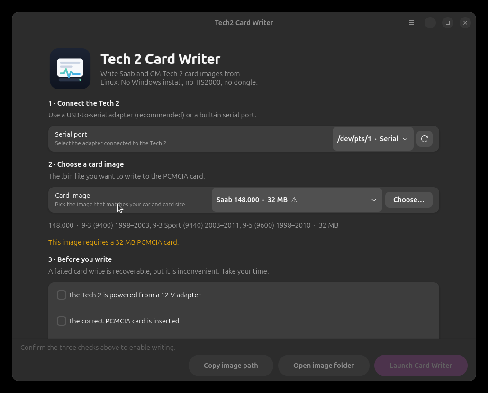

<p align="center">
  
</p>

<h1 align="center">Tech2 Card Writer for Linux</h1>

<p align="center">
  <em>Write Saab and GM Tech 2 PCMCIA cards from your Linux desktop —
  no Windows VM, no TIS2000, no dongle.</em>
</p>

<p align="center">
  <a href="docs/CARD-VERSIONS.md">Card versions</a> ·
  <a href="docs/HARDWARE.md">Hardware guide</a> ·
  <a href="man/tech2-cardwriter.1">Man page</a> ·
  <a href="CHANGELOG.md">Changelog</a>
</p>

---

> **What this is.** A GTK4/libadwaita front-end for the freeware Windows
> **Tech2 Card Writer** by AlexRE (2011), running through a private Wine
> prefix. It detects your USB-to-serial adapter, checks the `.bin` image,
> maps the adapter to **COM1**, and opens Card Writer with a short checklist.
>
> **What this is not.** It does **not** program ECUs, talk to the car, or
> replace TIS2000/SPS. It only writes the Tech 2 memory card. Card images are
> not included — supply your own.

## Why this exists

Writing a Tech 2 card normally means finding a Windows machine, installing the
old freeware writer, and hoping it still talks to COM1. This app keeps all of
that in one place on Linux: a private Wine runtime, a validated image picker,
and a safety checklist before anything is written.

<p align="center">
  
</p>

## Features

- **Native GTK4/libadwaita window** that fits GNOME, KDE, and everything else.
- **Automatic serial-port detection** — `/dev/ttyUSB*`, `/dev/ttyACM*`,
  and `/dev/ttyS*` — with a clear "permission denied" hint when udev is in
  the way.
- **Image validation before writing**: the `T2  ` header, exactly 10 MB or
  32 MB, version hints from the filename, and warnings such as "v44.000 is for
  the 900/9000, not the 9-5".
- **One-click Wine setup** — a private prefix under your home directory and a
  `COM1` mapping to the selected adapter.
- **Bundled Wine 11.20 amd64-wow64** in the `.deb` and release builds, so you
  do not need Wine on your system. Source installs can use system Wine.
- **Guided checklist**: 12 V supply, correct card, backup/risk acknowledged.
- **Logs for every run**, plus a CLI for scripting and pre-flight checks.
- **No binaries or `.bin` images in this repository.** The build fetches the
  original Card Writer and Wine from their official/archived sources and
  verifies SHA-256 checksums.

## Requirements

### Computer

| Item | Needed |
|---|---|
| OS | Linux x86_64 (Ubuntu 24.04+ or equivalent) |
| Desktop | GTK 4 and libadwaita 1.5+ |
| Python | 3.10+ and PyGObject (only when running from source) |
| Wine | Bundled in the `.deb`; system Wine otherwise |
| Permissions | Your user in the `dialout` group (or `uucp` on Arch/Fedora) |

### Hardware

| Item | Needed |
|---|---|
| Tech 2 | Genuine or clone unit with RS-232 port and PCMCIA slot |
| PCMCIA card | **Linear flash**, 10 MB for v44.000 or 32 MB for v135–v148 |
| Power | Stable **12 V DC** supply for the Tech 2 |
| Serial link | USB-to-serial adapter (recommended) or built-in serial port |
| CANdi | **Only for 9-5 model year 2006 and newer** |

See **[docs/HARDWARE.md](docs/HARDWARE.md)** for the full bench setup, serial
wiring, card compatibility, and the CANdi warning.

## Install

### Option 1 — prebuilt `.deb` (easiest)

A prebuilt `.deb` is attached to each
[GitHub release](https://github.com/ogden-marrow/tech2-cardwriter-linux/releases).
Download it and install it with `apt` so dependencies are resolved:

```bash
sudo apt install ./tech2-cardwriter_1.0.0_amd64.deb
tech2-cardwriter
```

The package bundles Wine 11.20 and Card Writer under
`/opt/tech2-cardwriter`, adds a desktop entry, icon, man page, and
`/usr/bin/tech2-cardwriter`.

### Option 2 — build the `.deb` yourself

`make deb` builds the same package locally. Install the build dependencies,
then build and install:

```bash
sudo apt install python3-gi gir1.2-gtk-4.0 gir1.2-adw-1 \
  build-essential curl unzip xz-utils desktop-file-utils man-db dpkg-dev

git clone https://github.com/ogden-marrow/tech2-cardwriter-linux.git
cd tech2-cardwriter-linux
make deb
sudo apt install ./build/tech2-cardwriter_1.0.0_amd64.deb
```

### Option 3 — install from source

Same build dependencies as above. The Makefile pins and verifies the downloads:

```bash
git clone https://github.com/ogden-marrow/tech2-cardwriter-linux.git
cd tech2-cardwriter-linux
make            # quick checks: syntax, tests, desktop file, man page
make fetch      # download Wine 11.20 + the original Card Writer (checksummed)
sudo make install            # install to /usr/local, uses system Wine
# or:
sudo make install-bundled    # install to /usr/local with the bundled Wine
```

Use a different prefix with `sudo make install PREFIX=/usr`, and remove it
again with `sudo make uninstall`. To hack on the app without installing:

```bash
make run        # launch from the checkout (fetches assets on first run)
make dev        # fetch assets, then run from a development install root
make check      # run the test suite, desktop-file and man-page checks
```

> **First fetch is a download.** `make fetch` pulls the portable Wine 11.20
> runtime (a few hundred MB) and the archived `cardwriter.zip` from
> AlexRE's original site, verifying their SHA-256 checksums. Nothing is
> bundled in git.

## Usage

1. **Set up the bench.** Connect the Tech 2 to its **12 V** adapter, insert the
   PCMCIA card, and connect the Tech 2 RS-232 port to your USB-to-serial
   adapter. Leave the car out of it.
2. **Start the app.** Run `tech2-cardwriter` or open *Tech2 Card Writer* from
   your application menu.
3. **Pick the serial port.** The app lists USB/ACM/serial devices. If your
   adapter shows *(permission denied)*, fix the `dialout` group first.
4. **Pick the card image.** Use the dropdown or **Choose…** and select the
   `.bin` file. Check the version, size, and any warning shown below it.
5. **Confirm the three checks** — 12 V supply, correct card inserted, backup or
   accepted risk. **Launch Card Writer** enables only when everything is valid.
6. **Launch.** On first run the app creates a private Wine prefix (about
   10–20 seconds) and exposes your adapter as COM1.
7. **Write the card in Card Writer.** Select **COM1**, click **Start**, and
   choose the same `.bin` file. Power the Tech 2 up before the write begins.
8. **Wait.** A 32 MB card takes roughly **15 minutes**. Do not touch the power,
   cable, or card until Card Writer reports success.
9. **Close Card Writer**, remove the card, and label it. Keep a copy of the
   image.

### Command line

```bash
tech2-cardwriter --list-ports
tech2-cardwriter --inspect ~/Saab/saab_148.000.bin
tech2-cardwriter --port /dev/ttyUSB0 --image ~/Saab/saab_148.000.bin
tech2-cardwriter --launch --port /dev/ttyUSB0
```

| Option | What it does |
|---|---|
| `--list-ports` | List detected serial ports and their access status |
| `--inspect IMAGE` | Validate a `.bin` file and print size, version, coverage, warnings |
| `--image IMAGE` | Pre-select the card image |
| `--port DEVICE` | Pre-select the serial device |
| `--launch` | Skip the GUI and start Card Writer directly |
| `--debug` | Keep Wine diagnostic output |
| `--version` | Print the version |
| `FILE` | Positional card image, same as `--image` |

## Which card do I need?

| Car | Image | Card |
|---|---|---|
| **Saab 9-5 (1999–2010)** | **v148.000** — newest general release | **32 MB** |
| Saab 900 / 9000 | v44.000 | **10 MB** |
| 9-3 / 9-5 older releases | v135.000–v147.000 | 32 MB |

v143.000 is English-only; v2.000 is a special 9-3 DTC build, not the general
9-5 card. The full table, language list, and validation rules are in
**[docs/CARD-VERSIONS.md](docs/CARD-VERSIONS.md)**.

Card images are **not** included. The repository ships no `.bin` files; get
them from your own Tech 2 media, a TIS2000 installation, or the
[Tech2Wiki Saab archive](https://tech2wiki.com/content/tech2_pcmcia/available_tech2_.bin-files/tech2_saab.html).

## Which USB-to-serial adapter?

Not all adapters are equal. The two safe choices:

1. **Tripp Lite USA-19HS (Keyspan)** — the GM/Bosch-recommended adapter, and
   the one explicitly validated in Saab's own Tech 2 software instructions
   ([NHTSA-hosted PDF](https://static.nhtsa.gov/odi/rcl/2016/RMISC-16V063-4886.pdf)).
   If you are buying one adapter, buy this.
2. **Genuine FTDI FT232R** — for example the US232R-100. Excellent Linux
   support and a reliable fallback.

**PL-2303 and CH340** adapters generally work, but the market is full of
counterfeits and marginal clones. If a write fails repeatedly or Card Writer
never sees the Tech 2, try a USA-19HS or genuine FTDI before blaming the app.
See the Tech2Wiki
[working USB-to-serial adapters](https://tech2wiki.com/content/tech2/tech2_using/connecting_to_techline/usb-to-serial/usb2serial_working.html)
list for tested models.

## Safety

> **Read this before your first write.**

- **Use a stable 12 V supply.** A 32 MB write runs about 15 minutes. Do not
  power the Tech 2 from the car, and do not unplug the adapter or remove the
  card while Card Writer is writing.
- **Never interrupt a write.** If it is interrupted, rewrite the card before
  using it. The card is recoverable; a half-written card is not usable.
- **Do not use CANdi on 2005 and older Saab vehicles.** CANdi is only for
  9-5 from model year 2006 onward. Card writing does not use CANdi at all.
- **Starting a write overwrites the whole PCMCIA card.** Make sure the card
  size matches the image: 10 MB image → 10 MB card, 32 MB image → 32 MB card.
- **Supply your own trusted image.** The app's checks catch wrong headers and
  sizes, not corrupted or modified software.

## Troubleshooting

| Symptom | Fix |
|---|---|
| Adapter shows *(permission denied)* | `sudo usermod -aG dialout "$USER"`, then log out/in (or `newgrp dialout`). On Arch/Fedora the group may be `uucp`. |
| No serial ports found | Check `lsusb` and `dmesg | tail`; install the adapter driver; try another cable/port. Built-in ports appear as `/dev/ttyS*`. |
| Card Writer does not list COM1 | Fully quit Card Writer and the app, then relaunch. Verify the mapping: `ls -l ~/.local/share/tech2-cardwriter/prefix/dosdevices/com1`. |
| Wine prefix creation fails | Read `~/.local/state/tech2-cardwriter/logs/wineboot.log`. Delete `~/.local/share/tech2-cardwriter/prefix` and relaunch to rebuild it. |
| "Card_writer.exe was not found" | Reinstall the package, or run `make install-bundled` from source. The executable should be under `/opt/tech2-cardwriter/app/` (deb) or `/usr/local/lib/tech2-cardwriter/app/` (source). |
| Image rejected as invalid | The first four bytes must be `T2  ` and the size exactly 10 MB or 32 MB. Re-download from a trusted source. |
| Card Writer opens but cannot connect | Recheck the adapter and cable; try `--debug`; test with the Tech 2 powered on and at its welcome screen. |
| Write fails partway | Do not panic. Power-cycle the Tech 2 and write the card again from the beginning. |
| App will not start (GTK/Adw error) | Install `python3-gi gir1.2-gtk-4.0 gir1.2-adw-1`, or use the bundled `.deb`. |

Every Card Writer run writes a log; the path is shown in the app after launch.
For deeper Wine output, launch with `--debug`.

## Files and logs

| Path | Contents |
|---|---|
| `~/.local/share/tech2-cardwriter/prefix/` | Private Wine prefix (created on first launch) |
| `~/.local/share/tech2-cardwriter/images/` | Optional image library folder |
| `~/.local/state/tech2-cardwriter/logs/` | `wineboot.log` and `cardwriter-YYYYMMDD-HHMMSS.log` |
| `~/.cache/tech2-cardwriter/` | Cache |
| `/opt/tech2-cardwriter/` | Packaged install (deb): `app/`, `lib/`, `share/`, bundled `wine/` |
| `/usr/local/lib/tech2-cardwriter/` | Source install location (default `PREFIX=/usr/local`) |
| `/usr/bin/tech2-cardwriter` | Launcher (deb); `/usr/local/bin/` for source installs |

Your Wine prefix, images, and logs survive package removal and upgrades.

## Legal and attribution

- **Card Writer** is © 2011 **AlexRE** (alexre.ru). It is freeware, not open
  source, and is **not** covered by this project's MIT license. It is
  downloaded unmodified from AlexRE's archived release and used only as the
  original author intended.
- **Tech 2 card images** (`.bin`) are © **Saab/GM**. This repository ships
  none and never will; you must supply your own.
- **Wine** is © the Wine contributors and is distributed under the
  **LGPL-2.1+**. The bundled runtime is the portable
  [Kron4ek Wine 11.20 build](https://github.com/Kron4ek/Wine-Builds).
- The Linux front-end and packaging in this repository are **MIT** licensed.
  See [debian/copyright](debian/copyright) for the full breakdown.

This is an independent hobby project. It is not affiliated with or endorsed by
Saab, GM, Bosch, or AlexRE.

## Links

- [Tech2Wiki](https://tech2wiki.com/) — the best Tech 2 reference on the web
- [Writing PCMCIA using Card Writer](https://tech2wiki.com/content/tech2_pcmcia/writing_pcmcia_cards/writing_pcmcia_using_tech2_card_writer.html)
- [Available Tech 2 .bin files — Saab](https://tech2wiki.com/content/tech2_pcmcia/available_tech2_.bin-files/tech2_saab.html)
- [Tech 2 PCMCIA kit](https://tech2wiki.com/content/tech2/tech2_kit/tech2_pcmcia.html)
- [USB-to-serial compatibility](https://tech2wiki.com/content/tech2/tech2_using/connecting_to_techline/usb-to-serial/usb2serial_working.html)
- [Tech 2 Saab software download instructions (NHTSA PDF)](https://static.nhtsa.gov/odi/rcl/2016/RMISC-16V063-4886.pdf)
- [Project on GitHub](https://github.com/ogden-marrow/tech2-cardwriter-linux)
- [Report an issue](https://github.com/ogden-marrow/tech2-cardwriter-linux/issues)

## License

MIT for the Linux front-end, packaging, and documentation — see
[debian/copyright](debian/copyright). Card Writer, Tech 2 card images, and
Wine keep their own licenses.